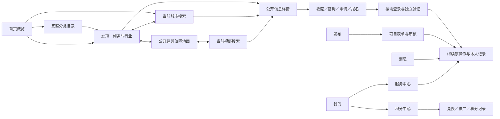

# 导向与条件统一规划 · 2026-11-05

本轮按现有26页、五个主导航规划，复用已有接口和业务流程。目标是让同一条件在不同入口含义一致，用户知道当前在哪里、看什么、范围多大、如何返回或放宽条件。

## 六个维度

| 维度 | 唯一职责 | 展示位置 |
| --- | --- | --- |
| 主导航 | 首页概览、发现浏览、发布提交、消息处理、我的管理 | 底部五导航，不承担内容分类筛选 |
| 信息频道 | 全部、招聘、房产、闲置、商家、服务、活动、便民 | 发现频道栏；搜索频道选择；地图仅全部/商家/服务 |
| 行业项目 | 27行业→分组→418项目，表达业务主题 | 共用三级行业选择器；不再另放同义行业标签 |
| 地域范围 | 手动浏览城市、区县/街镇、全市；地图额外有当前视野 | 城市入口及区划选择器；真实定位仅用于用户主动选择的距离条件 |
| 附加条件 | 关键词、发布时间、图片、可用范围内的距离/主体核验 | 搜索框与附加筛选；已选附加条件支持逐项移除 |
| 排序 | 推荐、最新、收藏热度；适用频道的价格或距离 | 排序入口；排序不冒充频道；缺少统一数据的薪资比较不宣称可用 |

频道与行业是相交条件，切换频道保持行业，不把行业选择偷偷清掉。条件过窄时显示空结果及逐项移除入口，不自动扩大城市或地图视野。

## 入口与状态矩阵

| 操作 | 应保留 | 应重新建立 | 返回/落地 |
| --- | --- | --- | --- |
| 底部进入发现、详情返回 | 当前列表条件、已加载页、滚动位置 | 身份/城市变化时重新请求 | 原发现页 |
| 首页行业、完整分类、首页频道指引 | 当前手动浏览城市与区划 | 显式入口指定的频道/行业；清除上一次关键词、时间、图片及距离 | 发现第一页 |
| 发现进入搜索 | 频道、行业、城市区划、关键词、时间、图片及合法排序/距离 | 搜索记录只记录主动提交的有效词 | 成功查询条件回流发现；未提交输入不回流 |
| 发现进入地图 | 适用的行业/城市区划、词、时间、图片 | 地图实际范围；不支持的频道明确说明并提供原列表入口 | 地图仅公开经营位置 |
| 地图进入搜索 | 实际视野、公开位置约束、主体核验、频道及其他条件 | 搜索结果和分页 | 返回地图同步成功查询条件 |
| 地图搜索切城市 | 地图约束及当前条件 | 先返回地图选择城市，再读取新城市视野 | 不把旧视野当成新城市的范围 |
| 切频道 | 关键词、行业、城市区划、时间、图片 | 清除不适用距离；不适用排序回到推荐/最新并提示 | 同页第一页 |
| 清空关键词 | 频道、行业、地域、其他筛选 | 关键词与提交词同时清空 | 当前范围无词浏览，不重新带回旧词 |
| 重置筛选 | 当前城市、频道、关键词；地图视野继续保留 | 清除行业、区划、时间、图片、距离和主体附加限制，恢复默认排序 | 当前频道更宽的结果 |
| 选择全市 | 当前城市与其他条件 | 仅清区划码 | 不等于全国，不改发布地址 |
| 更多分类 | 已保存的首页常用分类 | 默认完整行业目录 | 点击直接浏览，管理常用分类为独立模式 |
| 发布、收藏、私信等受限动作 | 原页面、输入和操作意图 | 交互登录、业务必需的独立手机号验证 | 继续既有登录恢复，不在公共浏览时请求登录 |

## 条件能力

- 时间统一为不限、近24小时、3天、7天、30天、90天；列表和地图使用同一枚举并通过真实接口验证。
- 行业三级、区划、图片条件覆盖发现、搜索、地图。价格排序只用于房产、闲置、服务；距离只用于全部/商家/服务中的公开位置，并要求用户主动授权。地图范围和GPS半径不叠加。
- 地图主体核验以有效商家主体记录为准，手机号验证不等于主体核验；列表不增加没有后端支持的“已核验”假筛选。
- 列表进入地图时明确说明价格、收藏热度或定位半径不能直接变为地图排序；原列表保留原条件，用户可以返回继续。地图搜索不接受GPS半径来替换实际视野。
- 租售意图、商品成色、岗位薪资区间、活动时间/名额等属于各业务结构字段。后续可按经审核、可比较的字段扩展专属筛选；本轮不增加只改标签而接口不处理的条件。

## 文件与验收

统一契约位于 `miniprogram/utils/browse-query.js`、`navigation.js`、`search-filters.js`、`map-filters.js`、`business-templates.js`；页面为 home/categories/discover/search/map；共用组件为 channel-tabs、browse-filters 与本轮的附加条件展示。后台继续使用现有feed/map权限、审核及公开位置约束，无迁移。

验收包含：新入口不带旧词；普通返回保留状态；有/无关键词均可切频道和筛选；旧词清空不复活；时间选项全链一致；频道切换保留行业及适用条件；重置只清约定维度；成功查询回流、过期请求不回流；地图不能越界扩成列表；分类浏览与常用入口编辑分开；空结果能逐项放宽。单元和真实隔离API验证完成后，冻结小程序源码做开发工具验收并保存截图。真机、真实微信及生产配置仍独立待验收。
