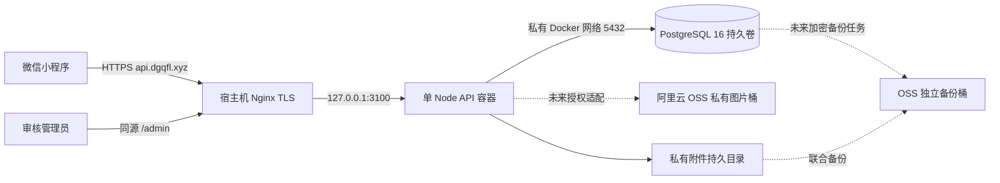

# 轻量生产部署架构（待批准）

日期：2026-11-01。适用目标：2核/2GB RAM/4GB swap/40GB，Ubuntu22.04.5。服务器参数和域名尚未远程核验。本轮没有生成或启用任何生产配置。

## 服务组成

- 宿主Nginx统一80跳转443、TLS、访问限流、上传并发、同源管理页面入口。`dgqfl.xyz`若使用，仅发布另行审核的静态介绍/协议页；原生小程序不能当成现成H5站点。
- API一个容器、一个Node进程，建议容器内部3100，`HOST=0.0.0.0`；仅映射宿主 `127.0.0.1:3100`。不暴露公网业务端口。
- PostgreSQL16保留现有兼容大版本，正式发布固定补丁版本和镜像digest。当前本地验证16.15，不代表目标机已安装。DB无host端口映射，只在私有网络访问。
- 不部署Redis、PM2集群、Elasticsearch、独立任务集群、Grafana/Prometheus套件。搜索复用当前PG查询；定时维护继续由单API运行，避免重复执行。
- 容器 `restart:unless-stopped`、`init:true`，API退出宽限建议90秒，持久卷不随发布替换。Docker healthcheck不健康本身不会自动重启，须额外外部告警/人工处置或经过审查的监督机制。

## 构建与版本

现无Dockerfile、生产Compose、Nginx文件；未来实现需单独审查。API复用Node与pg/sharp。拟用经过兼容验证的Node22受支持补丁版，固定镜像digest；本机20.19.4测试不能证明Node22已验收。

构建上下文必须覆盖项目根：后端引用 `../../miniprogram/utils` 及数据JSON，单独复制backend会缺文件。建立明确白名单：后端package/lock、src、admin、migrations，以及依赖所需的小程序utils/data；逐项验证导入路径。Linux CI构建 `npm ci --omit=dev`，不能复制Windows node_modules；sharp需目标Linux/CPU架构原生依赖。目标CPU架构待确认，不在2GB机器现场编译。

`.dockerignore`及发布包白名单须排除所有.env/本地状态/私有配置/上传目录/node_modules/截图/日志/测试制品，不能依赖.gitignore。无Git仓库时先建立经批准的VCS或使用源码SHA256清单与不可变镜像digest，禁止不存在的`git pull`流程。

## 网络和代理

- 管理端使用 `https://api.dgqfl.xyz/admin`，无需跨域开放。Nginx到API覆写 `X-Real-IP $remote_addr`，不能原样透传客户端伪造值。现源码忽略任意XFF链。
- `TRUSTED_PROXY_IPS`只支持逗号分隔的明确IPv4/IPv6，不支持CIDR。宿主Nginx经Docker映射端口后API看到的peer可能是桥接网关，必须用受控请求确认后填写并固定网络规划，不能直接假定127.0.0.1。
- `/api/v1/health`作低成本存活探测；`/api/v1/ready`建议30–60秒一次并检查连续失败，避免每秒执行完整schema校验。外部观察HTTPS、5xx、磁盘和备份结果。
- API需要出站443访问微信/可选腾讯地图及未来OSS；DNS、时间同步、证书续签也需允许。公网入站仍只22/80/443，SSH限制来源由后续实施审核。

## 存储和OSS规划

现状：普通图片及缩略图在PG bytea；私有资质附件在文件系统；生产资质收集入口禁用。**无OSS实现，新增环境变量不能生效。**

规划OSS与ECS同实际地域，分开私有媒体桶和加密备份桶，禁止公共写/列举，使用最小权限RAM角色优于长期AK。需要新增存储接口、对象引用元数据、写入失败补偿、校验迁移、删除/生命周期与回滚机制，均属后续业务改动。

媒体仍由API判断拥有者、已审核/未过期信息、商家状态、撤权与注销。头像和证照不得直接公共CDN暴露；需要即时撤权的图片优先通过API授权代理。若未来使用短期签名URL，须明确签名有效期内仍可访问的窗口并验收，不能声称撤销立即生效。普通公开图同样需要下架后的缓存失效策略。

私有附件挂载源码外，例如容器 `/var/lib/citylife/private`，非Web根目录，不挂载进Nginx；宿主专属目录最小权限。PG卷、附件卷、密钥及角色授权均纳入恢复清单。

## 数据角色和更新

初始化超级用户、迁移DDL角色、运行DML角色、备份角色分离；官方POSTGRES_USER初始化用户通常是超级用户，不能直接作API账号。源码没有角色创建/授权脚本，后续必须制作并验证权限，含序列、默认权限、未来迁移对象。

迁移用独立一次性任务和独立环境文件；日常API只检查版本，不在重启时迁移。生产升级前停写或维护窗口、完整备份、隔离恢复验证。无自动down迁移，回退必须结合版本兼容和数据库恢复点，详见迁移计划。

资源上限、备份和上线门槛分别见 `RESOURCE_BUDGET.md`、`DATABASE_MIGRATION_PLAN.md`、`DEPLOYMENT_RUNBOOK.md`。
