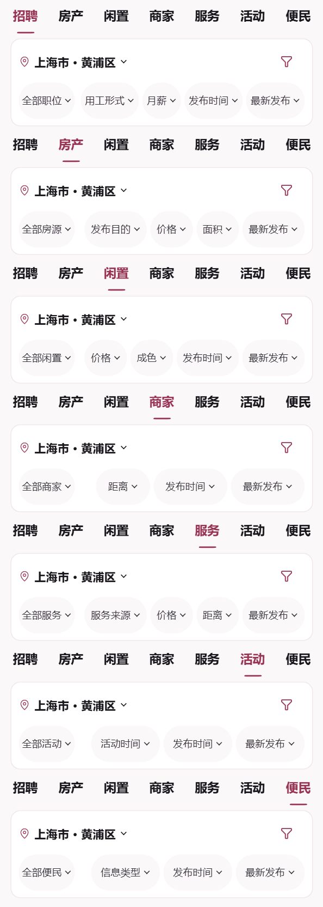

# 发现页筛选与服务中心入口调整

2026-11-13，基于 `626c202` 完成本轮专项修改。

## 已实现

七频道按项目现有的 27 个行业及 418 个细分类目匹配目录。各频道的快捷项如下，最后一项统一提供排序。

| 频道 | 快捷筛选 |
| --- | --- |
| 招聘 | 全部职位、用工形式、月薪、发布时间、排序 |
| 房产 | 全部房源、发布目的、价格或租金、面积、排序 |
| 闲置 | 全部闲置、价格、成色、发布时间、排序 |
| 商家 | 全部商家、距离、发布时间、排序 |
| 服务 | 全部服务、服务来源、价格、距离、排序 |
| 活动 | 全部活动、活动时间、发布时间、排序 |
| 便民 | 全部便民、信息类型、发布时间、排序 |

- 首次进入默认选中第一项“招聘”。从分类入口进入时使用入口指定频道，正常返回保留当前选择。
- 按用户最新反馈移除发现页“仅看图片”快捷项，将“最新发布”移到下方快捷行末尾。顶部漏斗按当前频道展示完整业务筛选、分类、地区、发布时间与重置入口，选中状态与快捷项同步。
- 业务字段通过共享定义规范化，经服务端校验后，在数据库分页之前执行。月薪使用区间相交，房产租售分别使用实际报价区间，面议和缺失数字在数字条件下被排除。
- 距离使用已核验公开商家及目录服务的位置。定位失败、关闭弹层、隐藏页面、切频道和账号变化均有过期响应检查。缓存包含业务条件、距离及定位原点。
- 搜索和地图携带适用的条件，支持删除条件、重置和返回同步。
- 个人中心的服务中心独立成卡，位于积分中心下方、我的功能上方。卡片使用柔和薰衣草表面、白色图标底座和分级文字，进入现有服务功能。

## 截图

截图由真实微信开发者工具生成。七频道截图读取本地 API，在页面内选择上海市黄浦区以统一检查布局。本地该地区查询结果为空，完整截图展示真实空状态。




完整截图分别为 `job.png`、`housing.png`、`used.png`、`merchant.png`、`service.png`、`event.png`、`public.png` 和 `me-service-card.png`。

七个 `*-panel.png` 文件展示各频道漏斗弹层。`job-options.png` 展示快捷字段弹层，`large-text.png` 和 `large-text-scrolled.png` 展示大字与横向滑动。

`sticky-layout-fixture.png` 使用明确标记的运行时布局夹具补足列表高度，用于测量吸顶位置。夹具仅存在于模拟器页面内存，页面重建后清除。业务筛选查询与分页通过独立 PostgreSQL 测试夹具验证。

## 自动检查

| 检查 | 结果 |
| --- | --- |
| 默认测试套件 | 497 项，481 通过，16 跳过，0 失败 |
| 隔离 PostgreSQL 专项 | 11 项全部通过 |
| 开发者工具交互检查 | 83 项全部通过 |
| WXML 元素嵌套检查 | 44 个文件通过 |
| 官方预览编译 | 成功，主包 2,067,090 字节 |
| 持久本地 API 与数据库重启检查 | 3101 就绪，迁移校验通过 |

默认套件中的跳过项包括需独立配置的 PostgreSQL 和集成检查。本轮 PostgreSQL 专项运行在 `citylife_pearl_test` 的临时 schema，覆盖数值边界、旧字段缺失、用工与月薪、租售与面积、闲置成色、服务来源、资讯来源、活动时间、地图条件及分页。临时 schema 已在测试结束时清理。

开发者工具检查覆盖七频道原生点击、筛选请求、频道漏斗标题与目录范围、弹层内业务选项及选中状态、重置、排序移动后的切换、搜索与地图往返、顶部吸顶、大字横向滑动、右下角入口及服务卡片位置和业务入口。

执行入口如下。

```powershell
npm --prefix backend test
node --test backend/tests/discovery-refinements.test.js backend/tests/discovery-channels.test.js
node scripts/check_discovery_refinements_ui.js
python scripts/check_wxml.py
```

PostgreSQL 专项执行时需要将 `PG_TEST_DATABASE_URL` 指向允许隔离测试的库。测试会验证目标名称，再创建与清理专用 schema。

## 修改文件

### 小程序

- `miniprogram/utils/discovery-refinements.js`
- `miniprogram/utils/browse-query.js`
- `miniprogram/utils/feed-query.js`
- `miniprogram/utils/navigation.js`
- `miniprogram/components/active-conditions/index.js`
- `miniprogram/components/browse-filters/index.js`
- `miniprogram/pages/discover/index.js`
- `miniprogram/pages/discover/index.wxml`
- `miniprogram/pages/discover/index.wxss`
- `miniprogram/pages/search/index.js`
- `miniprogram/pages/search/index.wxml`
- `miniprogram/pages/map/index.js`
- `miniprogram/pages/map/index.wxml`
- `miniprogram/pages/me/index.wxml`
- `miniprogram/pages/me/index.wxss`

### 后端

- `backend/src/discovery-refinement-query.js`
- `backend/src/pg-repository.js`
- `backend/src/memory-repository.js`
- `backend/src/geo-repository.js`
- `backend/src/server.js`

### 检查与验收

- `backend/tests/discovery-refinements.test.js`
- `backend/tests/discovery-sorts.test.js`
- `backend/tests/centers-browse.test.js`
- `backend/tests/page-quality.test.js`
- `backend/tests/me-layout.test.js`
- `backend/tests/search-booking-stability.test.js`
- `scripts/check_discovery_refinements_ui.js`
- 本目录中的截图、`ui-result.json`、`test-result.json` 和本报告。

## 待验证

Android 与 iPhone 的真机字体、实际 GPS 授权、系统大字与滚动体验等待用户提供设备。用户已选择先完成视觉和本地回归。

本报告覆盖发现页和此次个人中心入口调整。其他页面及生产上线条件的验收进度仍以各自记录为准。

## 回滚

本轮变更使用独立 Git 提交保存。需要回滚时，对本轮“Match discovery filters to real channel data and separate service center”提交执行 `git revert`，随后重新编译小程序并重启本地 API。

基线版本为 `626c202`。数据库使用现有结构，本轮隔离测试创建的 schema 已清理，持久库的迁移清单校验通过。
