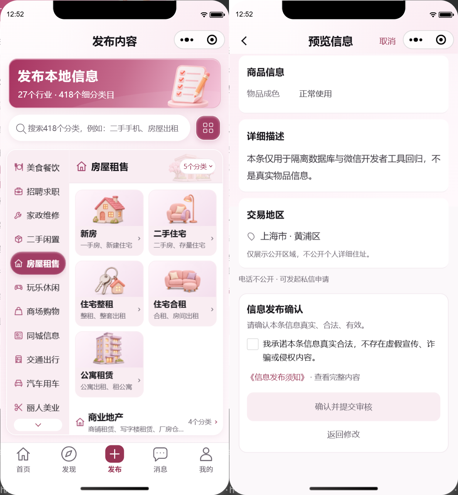

# 发布页与发布确认整改

2026-11-14，应用回滚基线为 `a9eb5a3`。

## 发布页

依据本轮参考图调整品牌横幅、搜索栏、四格工具按钮、左右目录、选中态、项目插画与卡片排版。发布须知、草稿箱、发布进度和常见问题默认收起，通过搜索栏右侧按钮展开。

沿用原有默认分类“二手闲置”。下图选中“房屋租售”，展示真实目录中的新房、二手住宅、住宅整租、住宅合租和公寓租赁。其余项目继续通过分组目录与搜索访问。27 个行业、83 个分组、418 个项目及五导航保留。

原尺寸实拍见 `publish-housing.png`、`publish-tools.png`、`publish-search.png`、`confirmation-unchecked.png`、`confirmation-checked.png`、`confirmation-stale-version.png` 和 `industry-confirmation.png`。截图来自微信开发者工具。表单及后台档案中的内容为明确标记的隔离测试数据。

房屋插画通过内置 imagegen 工具生成并修整透明背景，拆分为六张 216×216 PNG，共 87,567 字节。素材位于 `miniprogram/assets/publish/`，生成提示词及文件对应关系见 `image-prompts.json`。

## 发布须知与确认

用户提供的《信息发布须知与承诺》十二章已完整接入。初始版本为 `publication-1.0-20261114`，内容摘要采用 SHA-256。

- 发布页“发布须知”和确认卡片均可打开全文阅读。
- 居民发布预览、本人内容修改、行业业务提交和商家服务编辑共用确认组件。
- 复选框初始为空，勾选承诺后可以提交审核。编辑内容、返回修改和切换记录会清除本次确认。
- 须知版本过期时保留表单内容，重新加载当前须知并要求重新勾选。
- 草稿按原规则保存，提交审核时完成确认。
- 提交成功后进入平台待审状态，平台继续独立核查主体、授权、文字、图片和来源。

完整文案位于 `backend/legal/publication-notice.md`。公开读取接口为 `GET /api/v1/publication-notice`，小程序全文入口复用法律文档页。

## 后台记录

新增 `publication_confirmations`，与内容提交在同一个 PostgreSQL 事务中保存。

| 内容 | 实现 |
| --- | --- |
| 用户 ID | 服务端当前登录用户 |
| 发布信息 ID | 实际发布信息、行业信息或服务 ID |
| 须知版本 | 版本号、内容摘要及确认时的须知全文 |
| 确认时间 | 数据库服务器时间 |
| 对应内容 | 标题、正文、价格、地区、分类字段、图片 ID 与图片摘要、联系设置 |
| 内容版本 | 提交时的内容修订号及内容摘要 |
| 审核标准 | 对应行业规则及规则版本快照 |
| 后续处理 | 展示状态历史、审核操作、举报答复与关联账号处置记录 |

确认记录及展示状态历史通过数据库触发器保护原始内容。修改后重新提交会保存新的确认快照。相同请求编号重试保持单条提交与确认记录，确认落库失败会回滚本次内容提交。已进入确认档案的图片继续受历史引用保护。

新增 `publication_status_history` 记录本轮迁移生效后的状态变化。原有审核、举报和账号处理日志通过信息 ID 关联查询。历史内容的确认情况显示待核实，新增提交和修改复审开始留存确认。由行业信息连接的预约服务可继续读取来源业务的确认档案。

后台增加“发布确认与处理档案”查询区，以及内容审核、行业业务和服务任务中的档案入口。接口为 `GET /admin/api/publication-records/:id`，沿用运营权限及访问审计，资质原件继续走独立核验权限。实拍见 `admin-publication-records.png`。

## 独立行业规则

规则版本为 `review-1.0-20261114`。共用规则模块为 `miniprogram/utils/publication-review-rules.js`。

| 行业 | 核查重点 |
| --- | --- |
| 招聘 | 实际用工主体、发布授权、适用的人力资源服务资质、岗位与薪资工时、招聘收费及培训贷、用工条件 |
| 房产 | 本条房源权属或有效授权、经纪资格、真实房源与价格、用途及居住安全 |
| 医疗 | 实际机构与适用许可、获准范围、官方来源、诊疗边界及疗效宣传限制 |
| 教育 | 适用的办学或培训许可、登记与课程范围、师资、收费退款及招生承诺 |
| 食品餐饮 | 适用的食品经营许可或备案、实际主体、有效期、门店与经营范围、餐品及价格宣传 |
| 母婴 | 托育、护理及相关服务的适用资格、人员与服务安全范围 |
| 金融 | 持牌机构、官方公示、核准范围、目录展示边界、收益承诺与交易限制 |
| 二手及其他 | 物品来源、成色与缺陷、禁售范围、真实性、有效期、内容权利和隐私 |

行业主体核验展示对应资格检查项。公开审核展示对应内容检查项，服务端校验检查结果。资格有效期、项目范围、房源逐条核验、来源核对及既有开放状态继续参与审核和展示判断。418 项按既有准入分别进入居民表单、行业流程或论坛关闭路径。

## 实际验证

| 检查 | 结果 |
| --- | --- |
| 默认测试套件 | 506 项，489 通过，17 跳过，0 失败 |
| 须知、事务、权限、专项行业与 PostgreSQL 回归 | 37 项通过，0 跳过，0 失败 |
| 418 项完整业务链 | 420 项通过，覆盖 418 个项目，0 失败 |
| 微信开发者工具交互及后台档案 | 21 项通过，0 捕获的运行时异常 |
| WXML 嵌套检查 | 46 个文件通过 |
| 六主题共享语义色 | 180 组通过，最低对比度 4.93 |
| 本地数据库备份恢复与升级 | 通过，原有 72 张表、1,339 行数据比对一致 |
| 本地 API | 就绪，须知十二章可读取 |

测试计数存在交叉，具体输出汇总见 `test-result.json`。逐项业务链证据见 `../../project-journeys/integration-result.json`。界面检查见 `ui-result.json`。交互自动化使用原生事件回调夹具，并执行真实隔离 PostgreSQL 和 HTTP 请求。测试身份、核验材料与业务内容均采用隔离夹具。

## 数据库与回滚

新增第 033 份迁移 `backend/migrations/033_publication_confirmations.sql`，历史迁移校验通过。本地持久数据库已先备份，完成隔离恢复和迁移演练，再应用新增迁移。

备份路径、校验摘要及原始数据比对见 `local-upgrade.json`。备份保存在源码目录外。新增两张表后，本地数据库共 74 张表。

应用回滚时可恢复到 `a9eb5a3` 的应用代码，同时保留第 033 份迁移文件、迁移历史和已留存的确认档案。重新编译小程序、重启本地 API 并检查数据库迁移清单。数据库恢复演练使用独立恢复库核对数据。

本轮修改文件与交付物见 `CHANGED_FILES.json`。

## 待完成的验证

- 微信官方预览上传在本轮尝试中失败，开发者工具使用的 `127.0.0.1:10808` 代理连接被拒绝。当前编译上传包的准确大小待官方预览成功后复核。
- Android 与 iPhone 的真机字体、键盘、滚动和权限验收按此前安排后续进行。
- 正式微信凭据、HTTPS 合法域名与运营联系信息继续按项目上线配置清单处理。联系信息占位、微信单登录入口和手机号登录暂缓沿用用户此前决定。
- 运营人员仍需结合实际材料核验主体与行业资格，并完成每条内容的审核、举报和风险处理。
