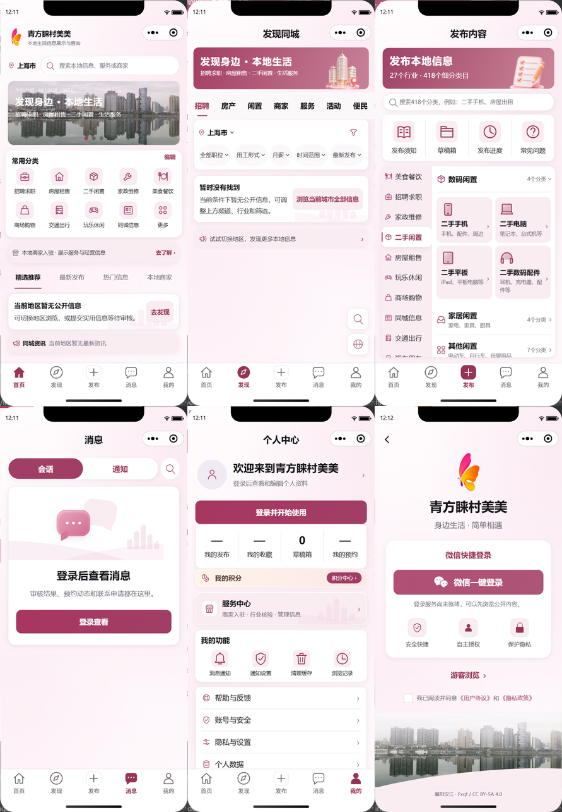

# 全站参考视觉统一与功能检查

2026-11-13，回滚基线为 `18d81a4`。

## 本轮交付

- 五个主页面和登录页采用参考图的珍珠粉白画布、烟玫瑰强调、白色柔光卡片、统一线性图标及圆角控件。
- 27 个页面共用背景、文字、按钮、表单、弹层及状态样式。首页分类和完整分类目录使用同一套主题图标。
- 首页提供真实城市摄影、分类编辑、商家入驻、真实信息流和资讯。发现页提供七频道实际筛选、排序、搜索及地图入口。发布页提供左右目录、分组卡片与分类搜索。消息页提供会话、通知和有品牌场景的登录状态。个人中心提供资料、本人数据、积分、独立服务中心与账户入口。
- 登录页采用独立品牌区、微信登录卡片、统一尺寸的三枚图标、游客入口、协议确认和城市摄影页尾。根据反馈，将登录状态调整为按钮下方文字提示，统一按钮禁用态和三枚图标的底座、尺寸与基线。
- Logo 使用以现有品牌图生成并检查过的透明 PNG。原始品牌图片和旧分类插画作为源码素材保存，当前界面使用的资源按预览包清单打包。
- 用户提供的 V1.0 用户服务协议共 14 条，隐私政策共 13 条，已接入服务端和小程序。客户端按标题、段落和列表呈现，文字可选择复制。登录同意记录使用更新后的版本号和内容哈希。
- 当前登录页面采用微信单入口。手机号授权验证继续在业务需要时使用独立授权流程。

## 实拍

`overview.png` 汇总五个主页面和本机登录状态。



`reference-*.png` 为参考风格的访客界面检查。`page-*.png` 及对应 `*-bottom.png` 覆盖 27 页的初始界面与滚动底部。独立业务页面使用真实隔离 PostgreSQL 和 HTTP API 返回的明确标记测试记录。

登录界面的不同状态分别见 `reference-login-unchecked.png`、`reference-login.png` 和 `login-local-status.png`。前两项使用隔离服务配置及显式协议选中回调检查界面状态，后一项显示本机真实登录配置状态。六种主题的登录检查保存在 `login-themes/`。

## 信息流与业务链

| 用户目标 | 已检查的路径 |
| --- | --- |
| 浏览与查询 | 首页、城市、频道及分类、结构化筛选、搜索、详情与返回上下文 |
| 发布实用信息 | 项目选择、草稿、适用资格、提交、审核、公开查询、修改复审、撤回及本人记录 |
| 行业业务 | 项目准入、资格核验、申请、答复、私密联系、业务约定、双方确认、取消、反馈处理与归档 |
| 来源信息 | 草稿、来源审核、公开查询、纠错、运营答复、修订复审、关闭及维护记录 |
| 服务预约 | 服务关联、时段容量、预约申请、商家确认、业务完成确认、取消和服务撤下 |
| 消息与隐私 | 联系授权、会话权限、通知入口、收藏、账号隔离、号码授权、数据请求及注销处理 |
| 积分权益 | 账本、兑换、库存、取消冲正、推广排期及记录 |

418 项逐项隔离 HTTP 业务链检查已通过。其中 415 项按适用的居民发布或行业业务流程检查，3 项按论坛关闭及本人记录查询流程检查。分类目录包含 27 个行业。40 项具备居民表单入口，375 项进入行业流程，实际提交仍按运行时分类开放状态、手机号、主体和项目资质校验。

服务预约申请、双方业务进度和积分权益记录分别执行其业务规则。当前服务端公开配置将积分权益标记为 `points_only`，现金支付标记为关闭。论坛发布及公开点赞评论回复的配置为关闭。

27 页的模板事件均在实际运行的页面上核对处理函数，并逐页检查原生胶囊安全区域、统一主题和界面渲染。具体事件清单和截图路径见 `ui-result.json`。

## 自动检查结果

| 检查 | 结果 |
| --- | --- |
| 默认测试套件 | 502 项，486 通过，16 跳过，0 失败 |
| 418 项业务链及 PostgreSQL、权益专项 | 444 项通过，0 失败 |
| 更新协议后的登录、数据库、筛选及权益专项 | 47 项通过，0 失败 |
| 全站开发者工具检查 | 89 项通过 |
| 登录六主题检查 | 18 项通过 |
| WXML 元素检查 | 45 个文件通过 |
| 共享语义色对比度 | 180 组通过，最低 4.93 |
| 官方预览编译 | 成功，主包 1,911,672 字节 |

逐项业务证据见 `../../project-journeys/integration-result.json` 和该目录的 `inventory.md`。本目录的 `inventory/` 包含分类入口、页面去向和语义色检查结果。`test-result.json` 汇总本轮实际执行结果。

主要执行入口如下。

```powershell
npm --prefix backend test
node --test backend/tests/project-journeys-integration.test.js backend/tests/workflows-integration.test.js backend/tests/postgres.test.js
node --test backend/tests/login-v1.test.js backend/tests/postgres.test.js backend/tests/discovery-refinements.test.js backend/tests/workflows-integration.test.js backend/tests/legal-copy-reference.test.js
node scripts/check_reference_system_ui.js
node scripts/check_login_visual.js
python scripts/check_wxml.py
```

数据库测试和全站界面检查使用经过隔离目标校验的 `citylife_pearl_test` 临时 schema，结束时清理。测试账号、主体材料引用和服务记录均带隔离标记。微信身份和手机号的接口测试使用提供方回调夹具。

## 运营文档

以下文件用于核对用户提供的文案和当前占位内容。

- [用户服务协议](./legal/青方睐村美美用户服务协议.md)
- [隐私政策](./legal/青方睐村美美隐私政策.md)

当前版本分别为 `terms-1.0-20261113` 和 `privacy-1.0-20261113`。联系地址、客服电话和联系邮箱按用户要求采用占位。隐私政策中的第三方服务清单安排在实际接入后补充。

## 正式上线前待补全

`readiness.json` 记录本机当前配置检查。持久本地数据库和 API 就绪，正式部署配置检查尚未通过。

- 微信服务端 AppID、AppSecret 及正式接入验证。
- 正式 HTTPS API 域名、微信合法域名与生产通信验证。
- 运营联系信息、实际第三方服务清单和适用的数据保留规则。
- 超级管理员独立凭据、生产私密材料目录和生产环境开关。
- 后台个人管理员账号及个人操作归责。现有后台使用角色凭据、角色权限和操作审计。
- Android 与 iPhone 扫码真机上的字体、键盘、权限、地图、弱网和持续滚动性能。
- 生产规模的媒体容量、备份监控及部署运维验证。当前普通图片使用 PostgreSQL，后台会话与部分限流使用单进程状态。

用户已确定先使用联系信息占位，先完成微信登录界面，手机号登录暂缓，设备验收稍后进行。本轮验证结论适用于当前本地界面、隔离 API 和数据库测试范围。

## 修改与回滚

`CHANGED_FILES.json` 列出本轮修改文件与新增交付物。

本轮以“Unify reference visuals and integrate supplied legal documents”独立提交保存。需要回滚时，对该提交执行 `git revert`，随后重新编译小程序并重启 API。

协议版本变更会参与新的登录同意校验。数据库历史同意记录保留原版本及摘要。本轮数据库迁移清单校验通过。
